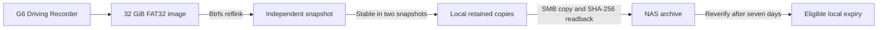

# Storage and failure handling

## One owner for the live recorder

The car owns the FAT32 volume. XpengUSB uses the Linux USB mass-storage gadget, derived from the upstream configfs design, with one camera LUN. It never mounts, repairs, trims or deletes files in that live volume. Arriving on home Wi-Fi does not disconnect the drive. There are no vehicle wake or power commands.



The image lives in a preallocated 96 GiB Btrfs container file on the OS's ext4 filesystem. The installer leaves at least 8 GiB free outside that container. Inside Btrfs, the worker reserves the logical camera-image size plus 8 GiB before adding retained footage. A reflink initially shares blocks; when the car overwrites them, Btrfs needs new space. This reserve is essential.

This conservative layout means the usable retained-copy budget is **at most roughly 24 GiB when the 32 GiB camera disk is full**, before Btrfs metadata and transient snapshot overhead: `96 - 32 - (32 + 8)`. This is not seven days of unlimited video. Measure your footage size; longer retention at high recording volume needs more capacity and a separate reviewed layout. Changing an installer constant is not a supported resize procedure.

## Capturing files

Every cycle (normally five minutes after the preceding cycle finishes), the worker makes an atomic reflink of the backing image. Only that independent snapshot is repaired with FAT tools and mounted read-only. No lazy unmount is used. If unmount or loop detach fails, the image is kept rather than deleted underneath a mounted filesystem.

Reflinking an actively written disk gives a **crash-consistent**, not application-consistent, view. The car may still have unwritten buffers. FAT repair may recover only some files. A file must appear with identical SHA-256 content in two successive distinct snapshots before ingestion. MP4 outer-box bounds and the presence of `ftyp`, `moov` and `mdat` are checked. This rejects obvious partial files; it does **not** prove every sample decodes or that the final recording has finished. In-car and NAS playback tests remain necessary.

Both `XP_DCIM` and `XP_EMER_DCIM` are scanned recursively. Sidecar files are copied unchanged after the same stability check. Missing roots simply mean no clips in that category. Paths are not executed as shell commands. Symlinks, unsafe paths and nonregular files are rejected. The original filenames and content digest identify recordings, so equal sizes and timestamps cannot hide reused-name footage.

Hashing the camera contents on a single-core Pi Zero W can be slow. The worker does not overlap cycles. Capture runs before each upload batch; each cycle transfers at most two pending clips and checks at most two expiry candidates, so a large backlog cannot monopolise every cycle. One large file or blocked SMB I/O can still delay the next capture. The first upload normally requires two completed snapshots, so five minutes is an interval, not an upload deadline. CPU, USB write speed, Wi-Fi throughput and snapshot overhead must be measured on the target Pi.

## Local and NAS copies

Persistent state and the local spool are private directories below `/var/lib/xpengusb/storage`. The SQLite ledger uses durable commits. Copy operations stream in bounded chunks. Temporary files are private and completed files are published atomically without overwriting a different existing file.

NAS layout:

```text
<SMB share>/XpengUSB/<device UUID>/
  XP_DCIM/<original subfolders>/<original stem>--<SHA256>.mp4
  XP_EMER_DCIM/<original subfolders>/<original stem>--<SHA256>.mp4
```

The UUID survives reconfiguration and prevents two installations from mixing archives. Preserve the configuration and ledger during recovery. The full SHA-256 suffix prevents reused filenames from overwriting older footage. Very long stems are shortened to fit filesystem limits; ordinary extensions remain playable. The ledger retains the original relative path.

SMB 3.1.1 is requested. The worker checks the actual mounted filesystem and configured `//server/share`; an unmounted directory is never accepted as the NAS. The share must support atomic hard-link publication. A missing feature, permissions failure, full NAS or mismatched content fails closed. There is no automatic downgrade to SMB 1, no filename-based overwrite and no completed NAS-file deletion.

After the destination is flushed and read back with matching SHA-256, a first-success timestamp is recorded. Copy retries do not restart an already recorded retention period. NAS contents are verified again before local expiry. NTP synchronization is required for upload receipts and expiry because the Pi Zero W lacks a battery-backed clock. A clock rollback pauses time-based operations.

## Limits and recovery

| Situation | Behavior |
| --- | --- |
| Wi-Fi or NAS absent | Continue local capture within capacity; retry NAS later |
| No synchronized time | Continue local capture; defer archive receipts and expiry |
| Copy interrupted | No success receipt for that unfinished copy; retry without deleting source |
| NAS final file differs from ledger | Refuse overwrite and local expiry; inspect the reported failure |
| Insufficient local reserve | Pause new capture; do not evict unarchived or unexpired retained copies |
| Snapshot cannot unmount/detach | Preserve snapshot; log failure and require recovery if persistent |
| Car overwrites a file before it is captured | It may be lost; software cannot recover data never ingested |
| Power loss during writes | OS, image, ledger or current recording can be damaged; no absolute recovery guarantee |

The OS remains a conventional writable Raspberry Pi OS installation; this preview does not claim the upstream read-only-root design's power-loss resistance. Do not pull power as a normal shutdown method. Use Safe Eject in the car and `sudo poweroff` when practical. The installer does not configure backups or a UPS. Safe unexpected-power testing belongs on disposable test footage before relying on this device.

The source car's port-power behavior and XGuard interaction are not inferred from other owners' posts. Test them on the exact G6/XOS build. Internal-storage-only recordings are outside this project's reach.
